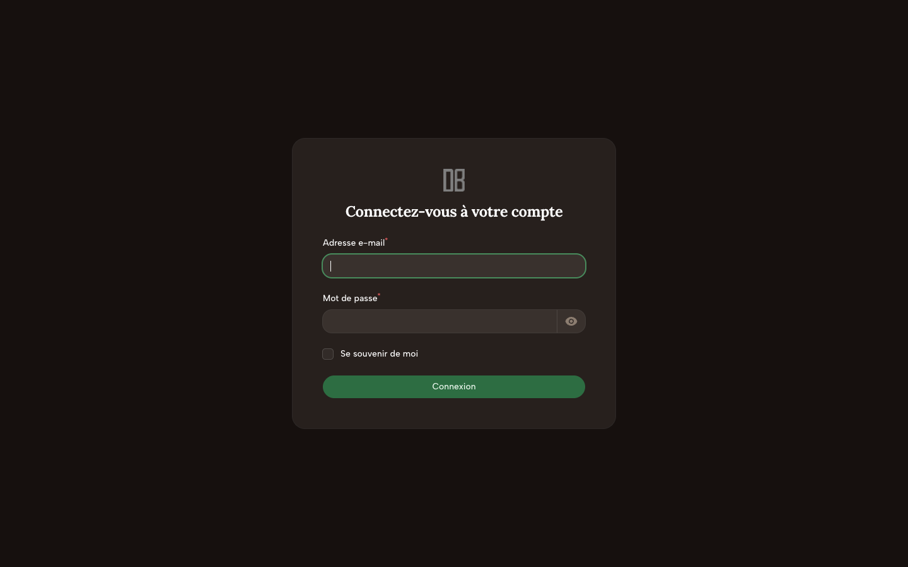
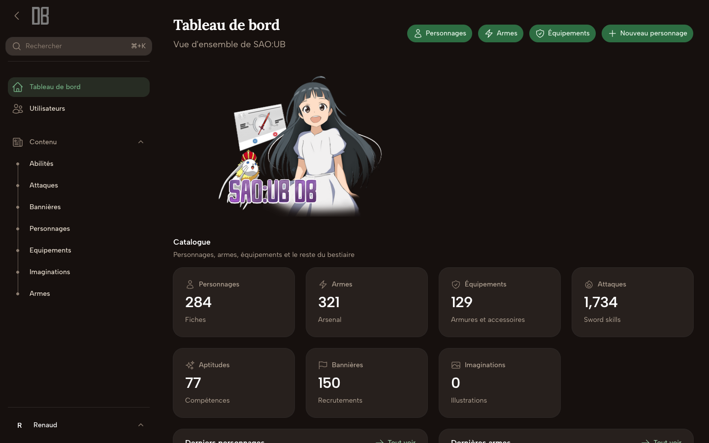
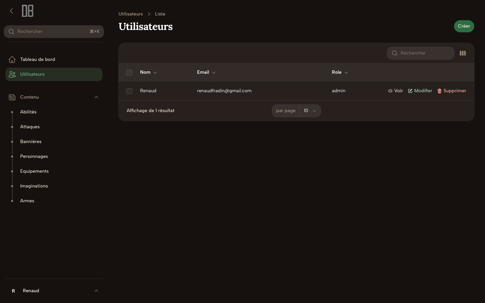
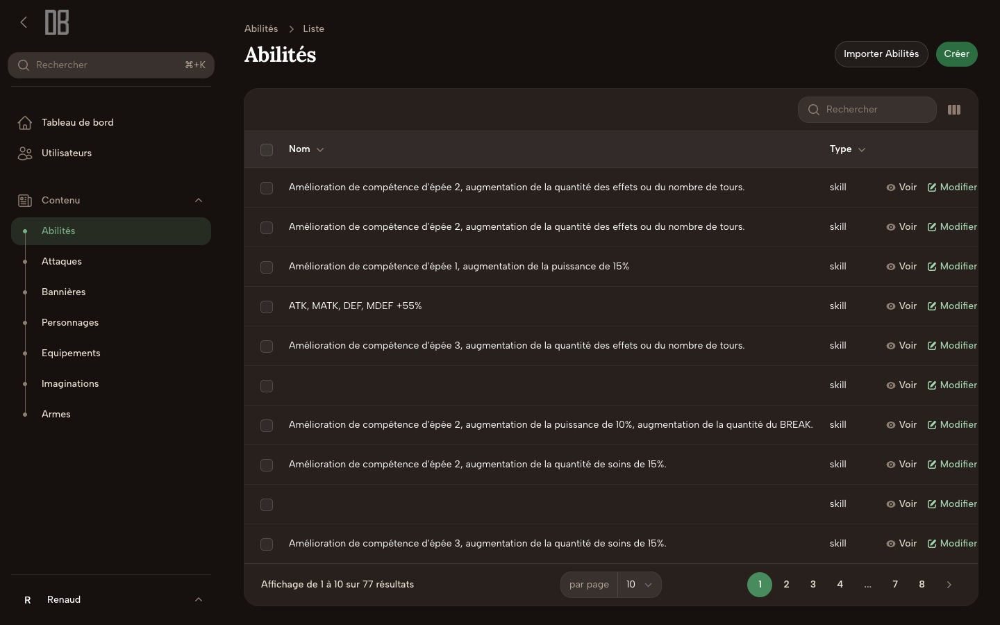
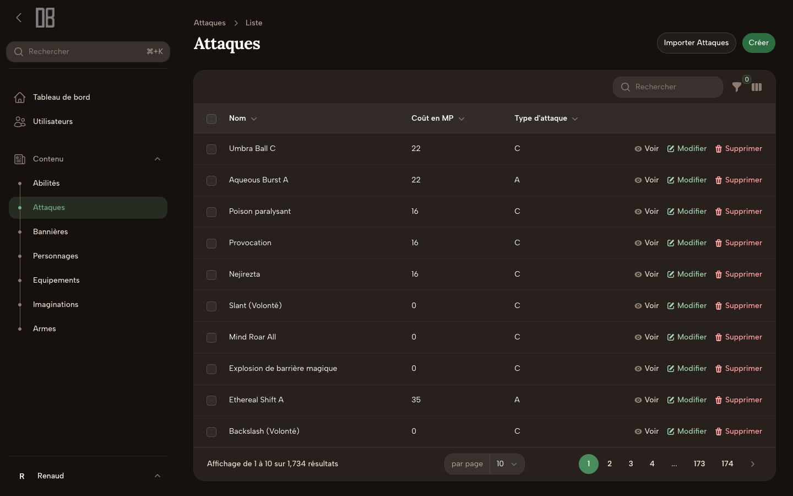
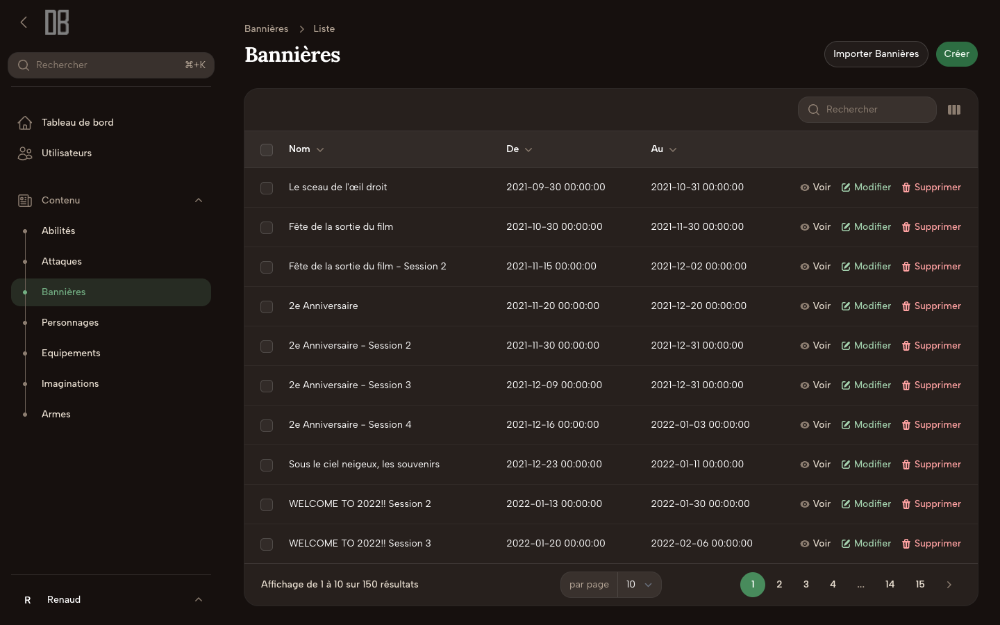
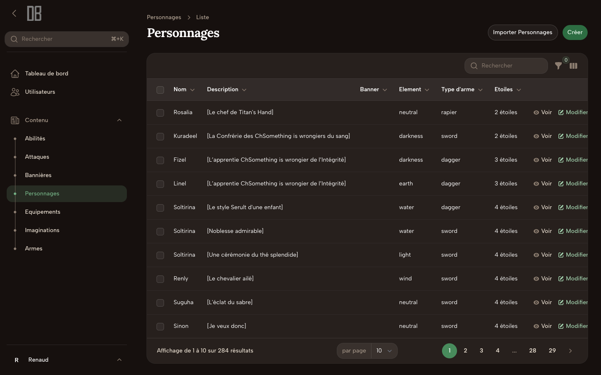
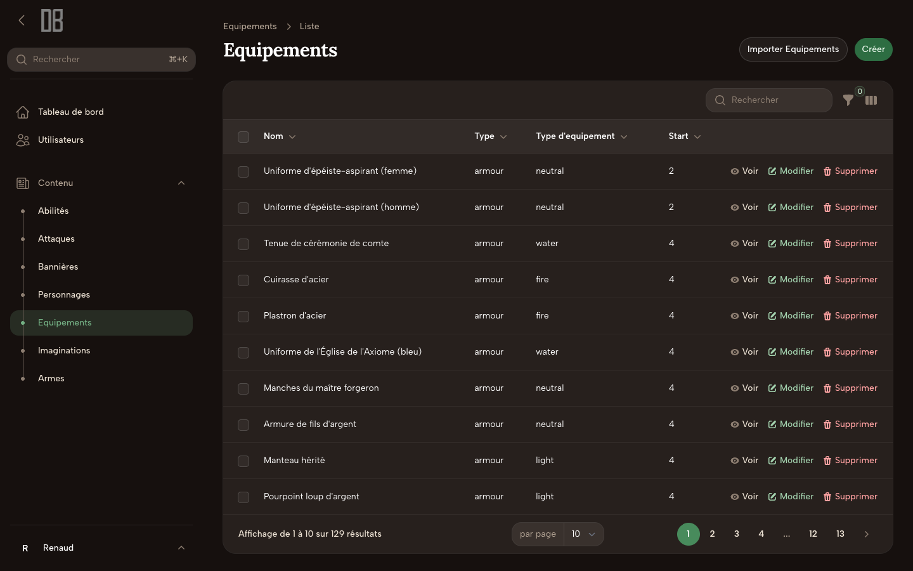
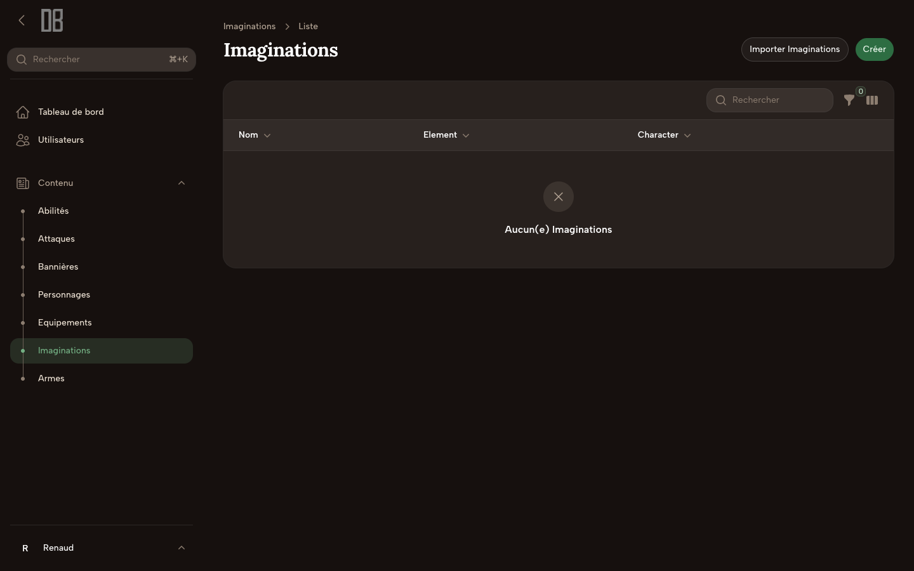
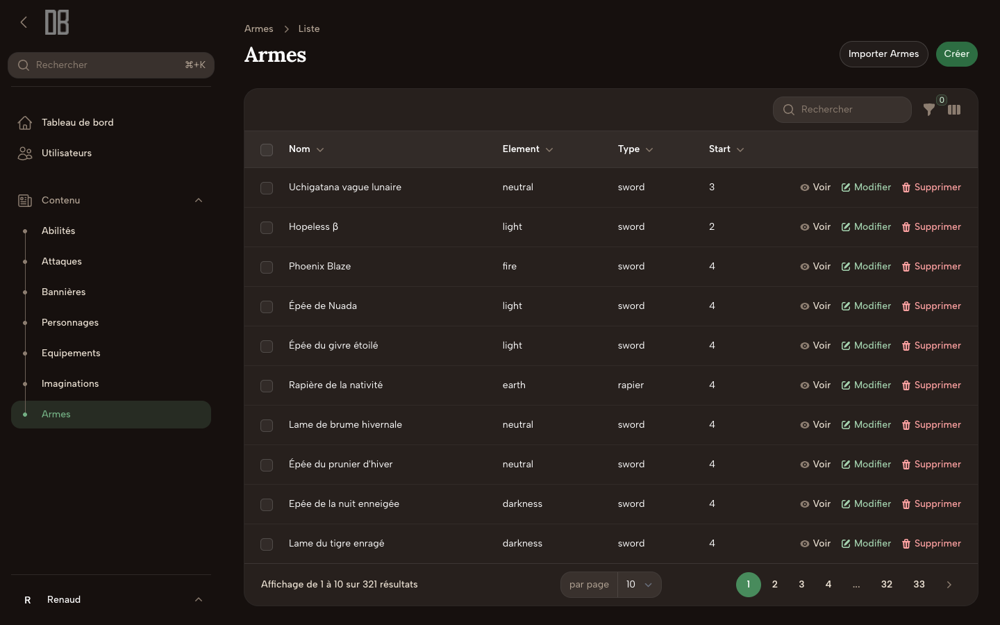

<h1 align="center">
  API-SAOARS
</h1>

## About

API that gathers characters and other information from the mobile game Sword Art Online Alicization Rising Steel / Unleash Blading.

Data/images related to the game Sword Art Online Alicization Rising Steel / Unleash Blading are credited to Bandai Namco Entertainment Inc. and other respective authors.

<br />

API qui regroupe les personnages et d'autres informations du jeux mobile Sword Art Online Alicization Rising Steel / Unleash Blading

Crédits des données/images relatives au jeu Sword Art Online Alicization Rising Steel/Unleash Blading à Bandai Namco Entertainment Inc. et autres auteurs respectifs

### Aperçu

| Connexion | Tableau de bord |
| --- | --- |
|  |  |

| Utilisateurs | Abilités |
| --- | --- |
|  |  |

| Attaques | Bannières |
| --- | --- |
|  |  |

| Personnages | Équipements |
| --- | --- |
|  |  |

| Imaginations | Armes |
| --- | --- |
|  |  |

### 🛠 Installation & Set Up

1. Install dependencies

```sh
composer install
```

2. Run migration and factory

```sh
./vendor/bin/sail migrate
```

```sh
./vendor/bin/sail artisan migrate:fresh --seed
```

3. Start the development server

```
./vendor/bin/sail up
```

4. Access the API

```
http://127.0.0.1:8001
```

### 📚 Documentation

[API Documentation](https://api-saoars.up.railway.app/api/documentation)

#### Bruno

The `bruno/` folder is a [Bruno](https://www.usebruno.com/) collection for the HTTP API. In Bruno, choose **Open Collection** and select that directory.

Environments live in `bruno/environments/`:

| Environment | `baseUrl` |
| --- | --- |
| Local | `http://localhost:8001` |
| CI | `http://127.0.0.1:8000` |
| Production | `https://api.saoars.example` |

Requests are grouped by resource: General (home, health, stats), Characters (list, show, random), Weapons, Equipments, Attacks, Abilities, Banners, and Imaginations. Show requests use the slug variables from the active environment and a `lang` query parameter.

Run the collection against the Local environment:

```sh
npm install
npm run bruno:run
```

The CI script writes a JUnit report to `reports/bruno-junit.xml`:

```sh
npm run bruno:run:ci
```
